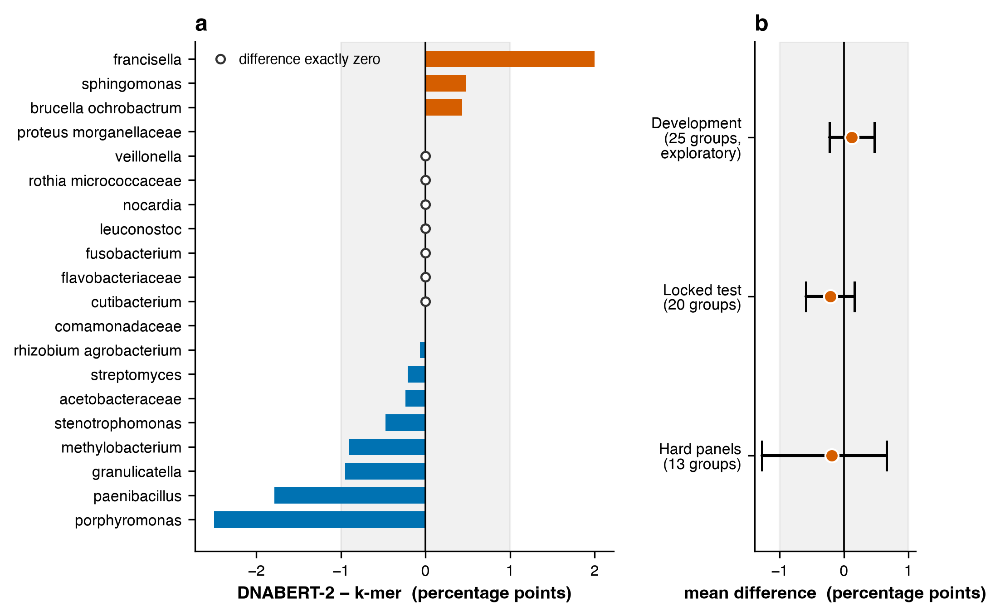
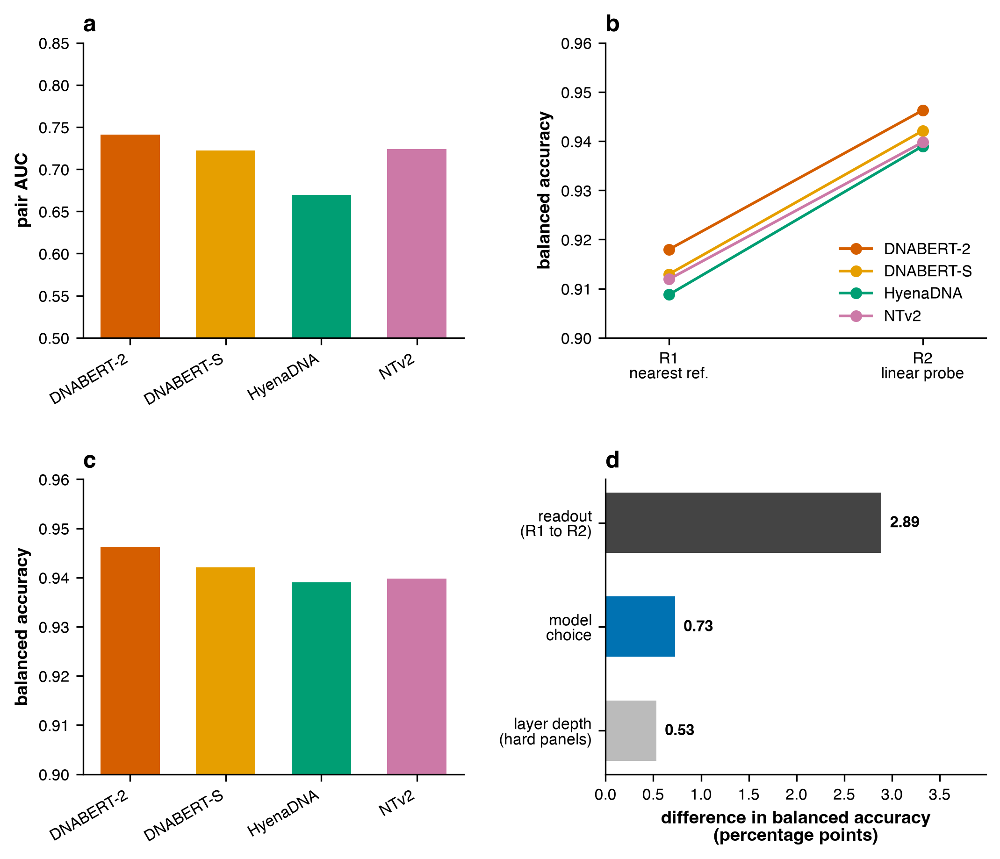
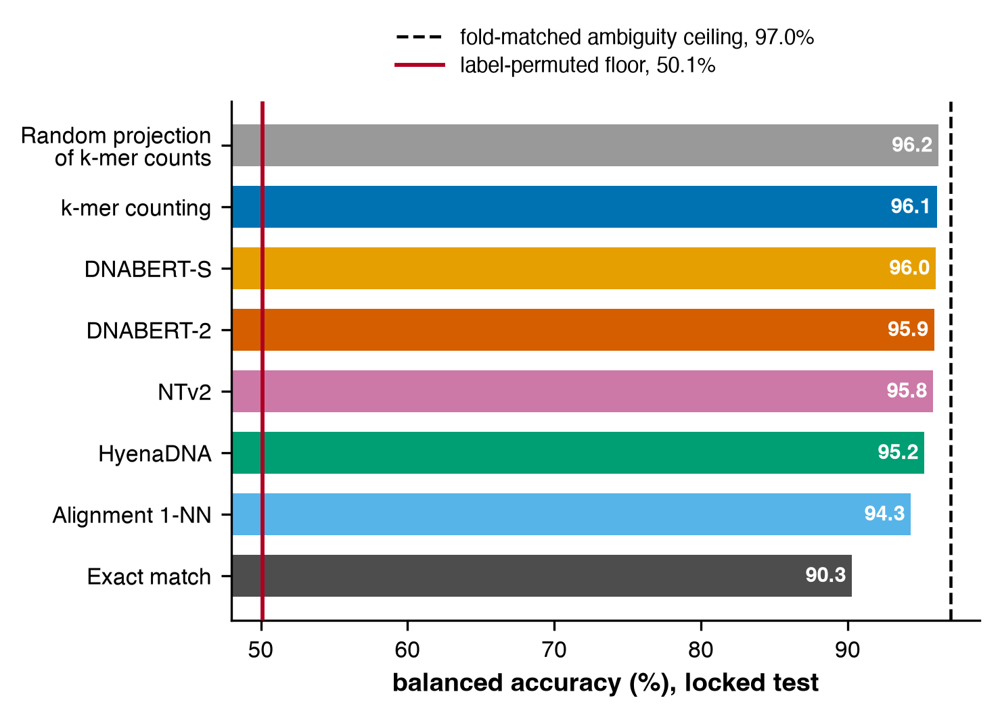
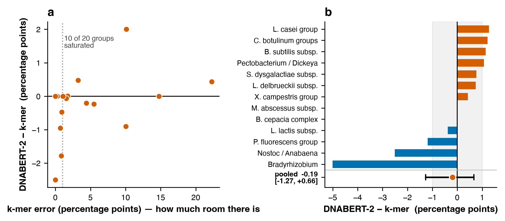
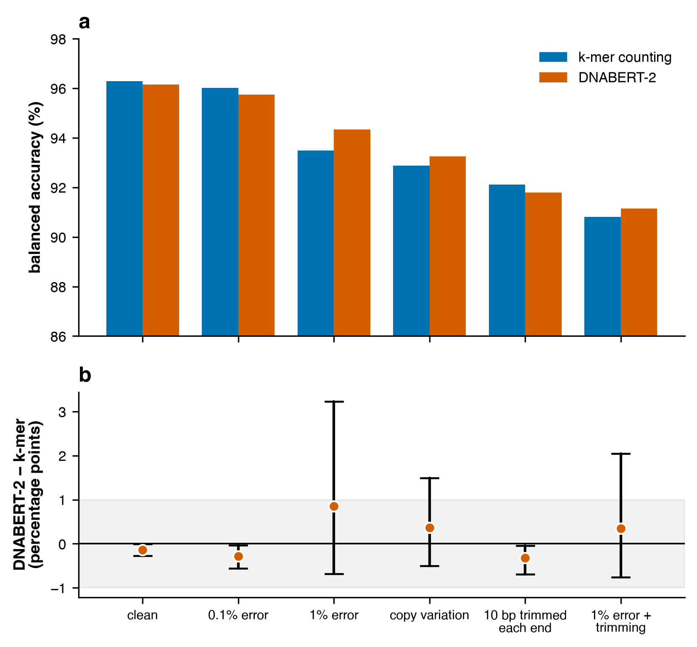
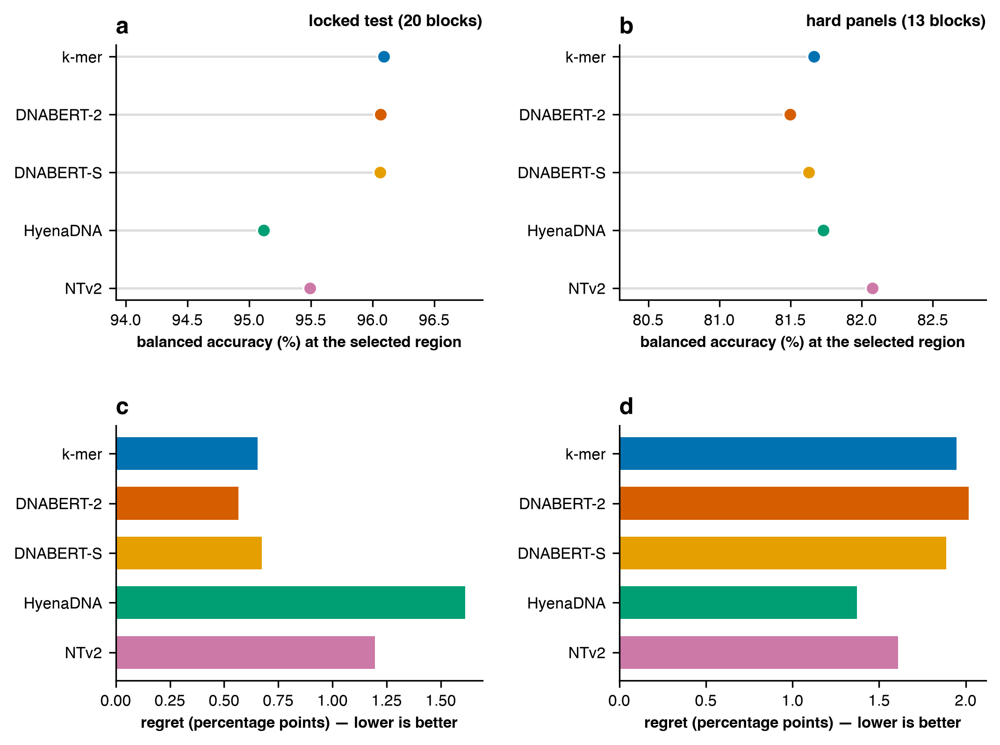
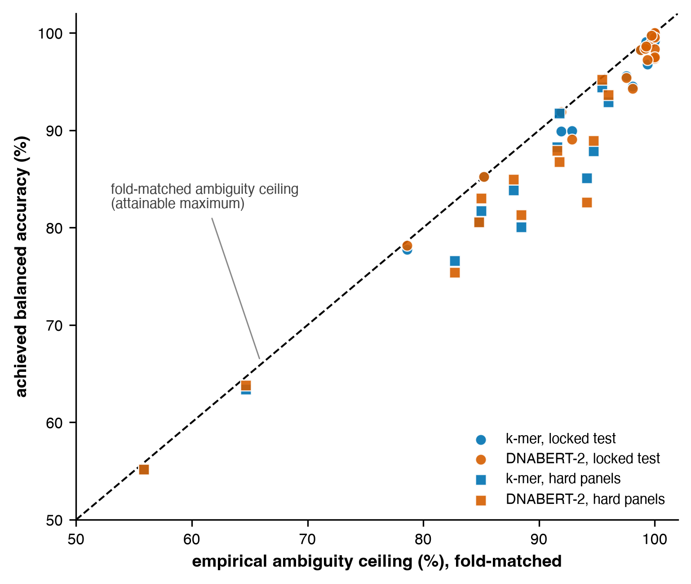

# Benchmarking Pretrained Genomic Representations for Fine-Scale 16S Discrimination

Manuscript draft for author review  
Article type: Original research, computational benchmark  
Version: 8 November 2026  

> Author verification required before submission. This draft uses the revised report and uploaded project files. It does not independently verify raw sequences, software execution, the new TOST p-value, or the new label-permutation results. Numbered AQ markers identify details requiring author completion; the full queries are provided in a separate document. Do not submit with unresolved queries.

## Abstract

### Background

Pretrained DNA language models generate sequence representations that may support genomic prediction. Their value for identifying bacteria from short 16S rRNA gene segments is unclear. Region choice, close-neighbor composition, and the method used to read a model's representation can all affect measured performance.

### Methods

We evaluated four pretrained DNA models, DNABERT-2, DNABERT-S, HyenaDNA, and Nucleotide Transformer v2, for closed-panel discrimination of a target taxon from three to six related taxa using individual 16S regions. Frozen model representations were evaluated with a linear probe and compared with 4-, 5-, and 6-mer features using the same probe. Additional analyses compared geometric and nearest-reference readouts, alignment, exact matching, a random projection of k-mer features, region selection, sequence perturbations, and selected intermediate layers. The confirmatory analysis used 20 eligible blocks from bacterial families excluded from the development set. Equivalence was assessed against a prespecified margin of ±0.01 balanced-accuracy units.

### Results

Across 58 analyzed groups in three separately reported strata (development, locked-test, and difficulty-selected; not pooled), the primary locked-test contrast, DNABERT-2 linear probe minus k-mer linear probe, was −0.21 percentage points (95% CI, −0.59 to 0.16; n = 20 blocks). The interval was within the prespecified ±1-point margin, and a paired-t two one-sided tests procedure yielded p = 4.1 × 10⁻⁴, with a distribution-free bootstrap interval as corroboration. DNABERT-S and Nucleotide Transformer v2 also met the equivalence criterion as a formal test (p_TOST = 4.9 × 10⁻⁵ and 1.4 × 10⁻³). HyenaDNA performed modestly worse than k-mer features (Holm-adjusted bootstrap p ≤ 0.004, at the resolution floor of a 2,000-draw bootstrap; paired-t Holm-adjusted p = 0.031); its interval was not wholly within the equivalence margin, and formal equivalence was tested and not established (p_TOST = 0.351). The average difference on 13 difficulty-selected groups was −0.19 percentage points (95% CI, −1.27 to 0.66), which did not establish equivalence at the ±1-point margin. Readout method was associated with greater variation in performance than model identity, confirmed on the locked test as a post hoc analysis: the nearest-reference to linear-probe change was +1.98 percentage points (95% CI, +0.69 to +3.61) against a 0.78-point model spread, a ratio of 2.5 (development: +2.89 points, 0.73-point spread, ratio 4.0). Sequence perturbations reduced accuracy in both primary methods, while model differences varied across conditions and were sensitive to individual panels. A random projection of k-mer features performed similarly to the original features; a separate label-permutation analysis was reported to yield near-chance accuracy.

### Conclusions

For the specified closed-panel task and evaluated readouts, pretrained DNA models did not show a meaningful advantage over k-mer features. The strongest formal equivalence evidence applies to the prespecified DNABERT-2 locked-test contrast, not to every model and extension. Interpretation depends on readout, assay region, reference sampling, and the matched definition of sequence ambiguity.

Keywords: 16S rRNA; DNA language model; genomic foundation model; k-mer; benchmarking; bacterial identification; taxonomic classification

## Introduction

The 16S ribosomal RNA gene is widely used to characterize bacterial communities and assign taxonomic identities. Many assays sequence a short portion of the gene rather than its full length. The choice of target region affects observed sequence variation and taxonomic assignment. Short variable-region reads do not always provide the resolution available from full-length 16S, and intragenomic copies can contain sequence variation that complicates interpretation. These limitations make species-level performance dependent on the organisms, region, reference sequences, and analysis method considered (Johnson et al., 2019).

Pretrained DNA language models offer another way to represent nucleotide sequences. Models such as DNABERT-2, DNABERT-S, HyenaDNA, and the Nucleotide Transformer were developed for genomic representation or prediction tasks (Zhou et al., 2024; Zhou et al., 2025; Nguyen et al., 2023; Dalla-Torre et al., 2025). Their representations may capture sequence patterns useful for downstream classification. However, good performance on broader genomic benchmarks does not establish an advantage for short, highly similar bacterial marker sequences.

This distinction matters because a model's performance depends not only on the information encoded in its internal states, but also on how those states are converted into predictions. A distance calculated between pooled embeddings, nearest-reference assignment, and a supervised linear probe are different readouts. Benchmarking studies of DNA models have compared zero-shot, probed, and fine-tuned settings, underscoring that a result from one readout should not be generalized automatically to all uses of a model (Patel et al., 2024).

The 16S region-selection problem also has prior computational work. V-Xtractor identifies and extracts hypervariable regions from small-subunit rRNA sequences (Hartmann et al., 2010). Primer-selection methods such as mopo16S optimize amplification-related properties, including efficiency and coverage (Sambo et al., 2018). Qscore evaluates combinations of amplicon, sequencing, annotation, and cost-related factors and provides recommendations based on expected microbial structures or habitats (Zhang et al., 2023). Therefore, the contribution of the present study is not simply to compare variable regions or to propose a user-facing selector. It is to benchmark pretrained sequence representations against classical sequence features for a defined target-versus-neighbor classification task, while examining how the evaluation readout and biological ambiguity affect the result.

We asked whether four frozen pretrained DNA models improve classification of a target species from its closest relatives using one 16S region, compared with k-mer features evaluated using the same linear-probe framework. We also evaluated a difficulty-selected set of panels, sequence perturbations, selected intermediate layers, and region-ranking performance. Our analyses were designed to distinguish a lack of useful model performance from limitations of the observed marker sequence, the reference population, or the chosen readout.

## Methods

### Study design and analysis phases

This was a computational benchmarking study with one development phase, one locked confirmatory test, and subsequent extension analyses. The main report lists 25 development groups, 20 locked-test groups, and 13 difficulty-selected groups, for 58 analyzed groups. The study-design table reports 31 development groups declared, 26 eligible, and 25 analyzed; 22 locked-test groups declared, 20 eligible and analyzed; and 15 hard panels declared, 13 eligible and analyzed. In total, 68 groups were declared, 59 were eligible, and 58 entered the main analyses — 58 = 59 eligible minus the one subspecies stratum reported separately. The 58 are not one homogeneous population and are never pooled into a single estimate: 25 species-rank development blocks, 20 species-rank locked-test blocks, and 13 rank-mixed hard panels, of which 7 are infraspecific by their own definitions. The locked-test split population is 6,599 isolate groups (6,760 across all 22 declared blocks, less 161 in the two blocks failing the eligibility gate). The report states that 30,797 sequence records were downloaded and 24,009 entered analyses. [AQ01]

Each group consisted of one target taxon and three to six related taxa. Eligibility required at least 10 target isolates and at least two neighbor species with at least five isolates each. Taxonomic rank was retained, and subspecies comparisons were not pooled with species-level panels. The development and locked-test groups were reported to have no overlap at the family level. The locked-test analysis plan was committed before the first confirmatory sequence was downloaded. The report records a 94-minute interval between plan commitment and the first download. [AQ02]

The locked-test primary contrast was prespecified as DNABERT-2 with the R2 linear-probe readout minus the k-mer linear-probe baseline. The locked set comprised 20 eligible blocks from 20 bacterial families reported as disjoint from development families. The hard-panel extension tested 13 groups selected using sequence properties and k-mer performance without using genomic-language-model results. [AQ03]

### Sequence acquisition and taxonomic panels

Sequences were retrieved from NCBI with accession, isolate and taxonomy metadata attached at fetch time. The unit of independence is the isolate group, formed from the deposited strain string (esummary `strain`, else the `strain` key parsed from `subtype`/`subname`), with placeholder values and bare culture-collection prefixes treated as missing and the accession used instead; no normalization was applied beyond that, so no case folding, no punctuation stripping and no catalogue cross-reference. A usable strain string was present for 23,459 of 24,009 analyzed records (97.7%). Aggressive renormalization would merge only 45 of 23,605 groups (0.19%), and 313 groups hold more than one record (717 records, largest group 6). The grouping key is submitter-deposited metadata, not verified independent provenance, and standalone 16S deposits carry no parent-genome link; the resulting error is under-merging, which is optimistic rather than conservative, and is stated as a limitation. [AQ04 resolved]

The study used both species-level and subspecies-level comparisons. The single development subspecies stratum was reported separately. Difficulty screening evaluated 53 candidate groups, of which 13 met the hard-panel eligibility criteria. The authors report that selection of hard panels was based on ambiguity ceilings and k-mer accuracy, not model performance. [AQ05]

### 16S regions and sequence processing

Candidate observations were extracted from 16S variable regions V1-V9, with the number of evaluable regions varying by panel. The region-ranking data report between six and nine regions for the locked set and seven to nine for hard panels. Extraction transferred Escherichia coli J01695 coordinates through a global Biopython PairwiseAligner alignment rather than using an HMM extractor, so that every method scores the same span; a region was retained only within 0.75 to 1.30 times its expected length, which recovered 187,889 of 216,081 region cells (87.0 percent), complete for V4 to V8 and lowest for the terminal regions V1 and V9. Ambiguous bases were retained, with N the only non-ACGT character present, treated as a mismatch by the aligner and skipped by the k-mer featurizer. No strand normalization was performed, and an audit found 22 of 24,009 records deposited reverse-complemented and silently mis-sliced; removing them moves the primary estimand by 0.003 percentage points and changes no verdict.

The primary classification analyses used clean reference sequences. For region ranking, each method selected a region using training isolates and was evaluated on held-out isolates. The report also includes sequence perturbations: substitutions at two error rates, removal of 10 bases from each end, copy-to-copy 16S variation, and combined perturbation. [AQ07]

### Models and representation readouts

Four published pretrained models were evaluated without retraining the encoders: DNABERT-2, DNABERT-S, HyenaDNA, and Nucleotide Transformer v2. Sequence representations were extracted from model outputs. The main frozen-model analysis used the final layer and a linear probe. The manuscript should state the exact checkpoint and tokenizer for each model, model revision or hash, sequence orientation, pooling function, truncation policy, inference precision, and software versions. These details are not present in the summary tables. [AQ08]

Three readout approaches were considered. R0 measured unsupervised geometric separation of embeddings using pairwise AUC; R1 used nearest-reference assignment; R2 used a supervised linear probe. R0 is a geometric discrimination statistic, not balanced classification accuracy. Therefore, numerical differences between R0 and R2 should not be described as a change in accuracy unless both are recalculated on the same endpoint. [AQ09]

An intermediate-layer sweep evaluated five depths for HyenaDNA and Nucleotide Transformer v2 on the 13 hard panels, at 0.25, 0.50, 0.75, 0.90 and 1.00 of encoder depth: layers 2, 4, 7, 8 and 9 of the 10 hidden states exposed by HyenaDNA, and layers 7, 14, 22, 26 and 29 of the 30 exposed by NTv2. Everything else was held fixed — the same masked-mean pooling, the same linear probe, the same isolate-grouped five-fold split, the same seed; only the layer changed. A correctness gate ran before any result was computed and aborts the analysis unless the extracted final layer is numerically identical to the standard forward output (allclose, absolute tolerance 1e-6); both models passed. DNABERT-2 and DNABERT-S were not swept because they run their encoder on unpadded sequences internally and return intermediate layers shaped (total tokens, hidden) rather than (batch, sequence, hidden), so extracting them correctly would mean reproducing their unpad/repad index logic. [AQ10]

The single layer-depth summary plotted in Figure 2d is a **range**, aggregated in this order: for each model and each depth, balanced accuracy is averaged across the 13 panels, giving five depth means; the range of those five (maximum minus minimum) is that model's depth effect; the two model values are then averaged, giving 0.53 percentage points. Because panels are averaged before the range is taken, this understates how much depth can matter on an individual panel; and because the depth was chosen on the same panels used for the comparison, any best-depth figure is optimistic rather than a bound. The quantity is a difference between two balanced accuracies — the best and the worst depth — which is what makes it commensurable with the other two bars in that panel: R2 minus R1 for the readout bar, and best minus worst model for the model bar.

### Classical comparison methods

The primary classical comparator was k-mer feature counting using 4-, 5-, and 6-mers with the same linear-probe framework as the model representations. Additional methods included exact sequence matching, pairwise alignment with tie-aware nearest-neighbor classification, and a random Gaussian projection of the k-mer features to 256 dimensions. The random projection is a distance-preserving compression under suitable conditions. It does not remove the biological sequence information in its input (scikit-learn developers, accessed 2026). The observed performance of this control therefore cannot establish that classifier flexibility, rather than sequence content, explains accuracy.

The revised report also describes a label-permutation analysis through the complete supervised pipeline, with 20 groups and 20 permutations. Permuted accuracies were approximately 50.1% for k-mer features and random-projected k-mers, and 50.2% for DNABERT-2, compared with observed accuracy around 96%. [AQ11]

An implementation note: the frozen plan specifies an isolate-grouped stratified five-fold split, and the code applies `StratifiedKFold` to an isolate-level table in which each isolate contributes one modal slice per region. These are equivalent, because one row per isolate makes the split grouped on isolate by construction. This is recorded as an equivalence, not a deviation.

### Outcomes and empirical ambiguity ceiling

The primary outcome was paired difference in species-balanced accuracy between the DNABERT-2 linear-probe method and the k-mer linear-probe method across locked-test blocks. The primary margin was ±0.010 balanced-accuracy units, equivalent to ±1 percentage point. The authors report that this margin was set before the confirmatory test. [AQ12]

The frozen precision plan sized the locked test using a development block-level SD of 0.01138. That SD belongs to the best-model-minus-best-classical contrast, not to the pre-named primary contrast; the achieved locked-test SD for the primary was 0.00889, so the study was planned more conservatively than it needed to be. The direction is favourable and is recorded here rather than left implicit.

The project calculated a reference-specific empirical sequence-ambiguity ceiling based on observed sequences, isolate units, species-balanced weighting, and the evaluated region. This ceiling is not a universal biological maximum. It depends on the composition and sampling of the reference population. [AQ13]

Two aggregations are possible and are not interchangeable. The whole-block ceiling evaluates the equation once on the full block population, whereas the reported accuracy is the mean of per-fold balanced accuracies, each computed on a fold with its own class composition; a fold mean can exceed a whole-population bound, and 3 of 66 block-by-method cells across the locked test and hard panels did so (both arms in *Veillonella* by 0.30 points, k-mer in *Bradyrhizobium* by 0.19). Figures reporting a ceiling therefore use the **fold-matched** ceiling — the same equation applied to each held-out fold at the region that fold selected, averaged over folds — which matches the aggregation of the accuracy it bounds, bounds all 66 cells, and differs from the whole-block value by 0.001 points on average (range −1.84 to +1.78). Per-block values for both aggregations are deposited. Like the whole-block version it is computed on held-out composition, so it bounds what any sequence-based rule could achieve on that fold rather than what a rule fitted on training data alone could.

Secondary outcomes included method-specific accuracy, results by hard-panel status, robustness to sequence perturbations, intermediate-layer performance, and the accuracy and regret of support-selected regions. The best-region reference used to calculate regret, how ties were handled, and whether it was common across methods require explicit definition. [AQ14]

### Statistical analysis

For the locked primary contrast, the project reports paired block-level bootstrap intervals based on 2,000 draws with seed 1729. The mean difference was −0.00211 balanced-accuracy units, with a 95% interval of −0.00595 to +0.00163. A two-sided bootstrap test of zero difference yielded p = 0.253. Equivalence and difference testing address distinct hypotheses (Lakens, 2017). The authors also report a formal two one-sided tests procedure against the ±0.010 margin. The primary test is a **paired-t TOST**, p = 4.1 × 10⁻⁴ (component one-sided values 4.11 × 10⁻⁴ and 3.72 × 10⁻⁶), with a parametric 90% interval of −0.00555 to +0.00133; the bootstrap 90% interval, −0.00529 to +0.00105, is distribution-free corroboration rather than independent replication, since both procedures analyse the same block-level differences. [AQ15]

Four secondary locked-test contrasts were adjusted using Holm's procedure. The hard-panel extension used a paired block bootstrap across 13 panels. The report characterizes that result as not supporting the hypothesis of model improvement; its 95% interval, −0.0128 to +0.0066, crosses zero and extends beyond the ±0.010 equivalence margin. It therefore does not establish equivalence at that margin.

[AQ16]

## Results

### Development and locked-test performance

The development benchmark analyzed 25 species-rank blocks across six bacterial phyla. The report gives a mean difference of +0.14 percentage points for the best linear-probe model relative to the best classical comparator, with a 95% block-bootstrap interval of −0.32 to +0.57 points. A family-grouped sensitivity analysis using 22 blocks yielded −0.01 points (95% CI, −0.48 to +0.42). These were development results and informed the locked analysis rather than serving as the confirmatory test. [AQ17]

In the locked test, DNABERT-2:R2 minus C_kmer was −0.21 percentage points (95% CI, −0.59 to +0.16; 20 blocks). The entire reported interval fell within the prespecified ±1-point margin. The revised analysis reported paired-t TOST p = 4.1 × 10⁻⁴, with a 90% interval of −0.56 to +0.13 points (bootstrap 90% interval −0.53 to +0.11). These results support practical equivalence for this prespecified contrast in the locked-test population, for the stated endpoint and prespecified margin. The interval does not show that the approaches are identical in every group or setting.

The report lists 17 of 20 blocks as within ±1 percentage point, one favoring the model by more than one point, and two favoring k-mer by more than one point. Mean balanced accuracy was 96.1% for k-mer counting and 95.9% for DNABERT-2 in the primary results table. A separate clean robustness summary gives slightly different values because it fixes one region per panel rather than reselecting across folds. These analysis variants should remain separately labeled.

DNABERT-S and NTv2 met the equivalence criterion as a formal test, not merely by interval width: p_TOST = 4.9 × 10⁻⁵ and 1.4 × 10⁻³ respectively, Holm-adjusted within the secondary family as a post hoc sensitivity to 1.7 × 10⁻⁴ and 2.9 × 10⁻³. HyenaDNA was lower than k-mer by 0.88 percentage points (95% CI, −1.48 to −0.38). Its raw bootstrap p rests on a single draw of 2,000 and is therefore reported as ≤ 0.001, Holm-adjusted ≤ 0.004; the better-resolved paired-t gives p = 0.0077, Holm-adjusted 0.031. Although the difference was statistically distinguishable from zero, the interval was not wholly inside the equivalence margin, and equivalence was formally tested and **not** established (p_TOST = 0.351, component one-sided values 0.351 and 2.17 × 10⁻⁶). The best-of-four model comparison was +0.29 points, but did not survive Holm correction (p = 0.075) and should not be interpreted as evidence of model complementarity.

### Performance of individual methods and controls

On the locked test, mean balanced accuracies in the method-performance table were 96.2% for random-projected k-mer features, 96.1% for k-mer features, 96.0% for DNABERT-S, 95.9% for DNABERT-2, 95.8% for NTv2, 95.2% for HyenaDNA, 94.3% for alignment, and 90.3% for exact matching. These are descriptive means across 20 blocks. The random-projection result shows that a compressed random linear transformation of k-mer features retained competitive performance. It does not establish that k-mer biology was removed or that the probe learned from noise.

The authors report that label permutation through the full supervised pipeline reduced all three tested arms to approximately 50.1% to 50.2% accuracy. This is consistent with the observed classification depending on sequence-label association under the tested permutation scheme. The limited number of permutations makes this a diagnostic control rather than a precise estimate of the extreme null tail.

### Readout and model comparisons

Performance differed across readout approaches. The project reports R0 geometric pair AUC, R1 nearest-reference classification, and R2 linear-probe classification. R0 and R2 are not the same metric. Accordingly, we do not interpret their raw numerical difference as a direct change in balanced accuracy. Among classification readouts measured on the same endpoint, development balanced accuracy increased by approximately 2.8-3.0 percentage points from nearest-reference assignment to the linear probe, whereas the linear-probe mean varied by approximately 0.7 points across the four models. These are descriptive comparisons, not a randomized causal decomposition. The qualitative pattern in the pilot was that geometric separation did not consistently predict supervised classification performance. For example, the pilot reports DNABERT-2 staphylococcal V1 performance of 0.923 for R0, 0.950 for R1, and 0.964 for R2, against a matched empirical ceiling of 0.982. On some Bacillus-group regions, R0 suggested separation even when the target-class ceiling and supervised performance were low. [AQ18]

An earlier small analysis had reported DNABERT-2 at chance on *Staphylococcus aureus* V1. In a later pilot with more records and isolate-grouped evaluation, the same model with a linear probe reached 96.4% balanced accuracy, near the reported 98.2% ceiling. This documents a consequential change in analysis and interpretation. It should be described with the sample sizes, exact split, and readout changes so readers can understand why the estimates differ.

### Difficulty-selected panels

### Sequence reuse and what the confirmatory result bounds

Isolate-grouped cross-validation does not make the folds sequence-disjoint, because identical 16S sequences recur across strains. At each block's modal selected region, 5,552 of 5,977 isolate groups (92.9%) share their exact slice with at least one other group, 1,348 (22.6%) sit in a haplotype carrying both classes, and across folds 5,431 of 5,902 evaluated isolates (**92.0%**) have their exact slice present in the training folds. The confirmatory result therefore characterises discrimination **within a known haplotype population**; it is not a measurement of generalisation to unseen variants.

Three post hoc analyses quantify the cost, all at a fixed region with the splitter as the only difference. Exact-sequence-disjoint folds are feasible for 14 of 20 blocks; the other six have ≤4 distinct target haplotypes. The split was audited, not assumed: exact train–test overlap is zero and `C_exact`, which abstains when a test sequence is absent from training, scores exactly 0.500 on every block (against 90.62% under the published design). Both primary arms then lose ~11 points — k-mer 96.36 → 85.42, DNABERT-2 96.16 → 84.92 — and the paired contrast is −0.50 pp (95% CI, −3.20 to +2.07). The direction does not reverse and no model advantage appears, but the block-level SD rises 14-fold, from 0.37 to 5.16 pp, so equivalence at ±1 point is **inconclusive** rather than established on unseen haplotypes. Single-linkage clustering at 99% identity, audited to a maximum cross-fold identity of 0.9894, gives −1.47 pp and the same verdict on the 9 blocks that support it.

A direct test of the mechanism gives a negative result. DNABERT-2 loses 11.24 points against k-mer's 10.94 when exact matches are removed — a difference of −0.30 pp (95% CI, −2.92 to +2.22), with the model degrading less in only 3 of 14 blocks. Giving each representation its own regularisation strength by nested inner cross-validation on a shared grid does not change this; under the disjoint split, tuning helps k-mer most. (The grid's lower boundary, C = 0.01, is selected in most fold-arm decisions, so the tuned figures are a lower bound rather than a converged optimum.)

Decomposing the pooled metric by neighbour species locates the difficulty. Across 63 target–neighbour pairs, performance is governed almost entirely by whether the two taxa share sequence at the evaluated region: pairs whose closest sequences differ at all resolve at 97–99%, while the 22 pairs reaching ≥99.9% maximum cross-identity — in every case because the neighbour shares a haplotype with the target — fall to 85.9%. Accuracy correlates with maximum target–neighbour identity at Spearman −0.62 (k-mer) and −0.58 (DNABERT-2). The method difference stays within 0.25 points in every divergence stratum while difficulty swings 13 points, so target–neighbour sequence identity governs performance by about two orders of magnitude more than the choice of representation.

The hard-panel analysis included 13 eligible groups chosen using ambiguity and k-mer performance, without using model scores for selection. Mean k-mer accuracy was approximately 81.8%, compared with approximately 96.1% in the locked test. The mean DNABERT-2 minus k-mer difference was −0.19 percentage points (95% CI, −1.27 to +0.66). Four panels favored DNABERT-2 by more than one point, three favored k-mer by more than one point, and six were within the prespecified ±1-point band. The interval contains zero but extends beyond the equivalence margin. Thus, the result did not show a reliable average advantage for DNABERT-2, but it did not establish equivalence within ±1 point.

The post hoc correlation between task difficulty and relative model advantage, observed in five locked-test groups, was not supported in the separate hard-panel extension. The report gives the largest individual hard-panel difference as −5.0 points for *Bradyrhizobium*, favoring k-mer features. This correlation should be presented as exploratory and non-replicated, not as a confirmatory result.

Screening also found high accuracy in several groups selected because their 16S was reputed to be conserved, while low accuracy was concentrated in selected subspecies comparisons and species complexes. Because taxonomic rank was not prespecified as a predictor and was not formally modeled, this is descriptive of the screened panels. It does not support the general claim that rank predicts difficulty better than genus reputation.

### Sequence perturbation analyses

The robustness extension evaluated DNABERT-2 and k-mer features on the same 20 locked-test panels under clean input, 0.1% and 1% substitutions, 10-base trimming at each end, copy-to-copy variation, and combined 1% substitution plus trimming. Results varied by condition. The reported paired differences, in percentage points for DNABERT-2 minus k-mer, were −0.14 (clean), −0.28 (0.1% substitutions), +0.85 (1% substitutions), −0.32 (trimming), +0.37 (copy variation), and +0.34 (combined). The reported intervals for 1% substitutions, copy variation, and the combined condition were wide and crossed zero. They do not establish equivalence within ±1 point.

The report identifies *Francisella* as a highly influential panel in the apparent 1% substitution advantage. Excluding that panel changed the mean difference from +0.99 to −0.06 points in a separate paired-shift summary. The direction was not stable across leave-one-panel-out analyses. This does not support a general noise-robustness advantage for the language model.

Accuracy decreased under several perturbations for both methods. In the supplied summary, trimming 10 bases from each end was associated with a larger average reduction than 1% substitutions. However, the trimming effect was concentrated in a small number of groups, and fixed trimming is not a direct model of primer mismatch or PCR dropout. The substitution model was also uniform and does not reproduce position- or context-dependent sequencing errors. These analyses are sensitivity tests, not empirical sequencing validation.

### Intermediate-layer evaluation

Five depths were evaluated for HyenaDNA and NTv2 on the 13 hard panels. For HyenaDNA, mean accuracy ranged from 82.86% to 83.40%; the best observed layer was layer 8, 0.16 percentage points above the final layer. The interval for the best-layer gain included zero, and layer selection on the same panels makes this estimate optimistic. For NTv2, the final layer was the best of the five evaluated depths. Intermediate layers of DNABERT-2 and DNABERT-S were not evaluated because their internal unpadding implementation required additional validation. These results narrow the layer limitation for two models but do not establish that final-layer pooling is optimal for all four.

### Region selection

A separate analysis evaluated whether each method could select a region using support isolates and then perform well on held-out isolates. In the locked test, mean selected-region accuracy was 96.1% for k-mer features, 96.1% for DNABERT-2, 96.1% for DNABERT-S, 95.1% for HyenaDNA, and 95.5% for NTv2. Mean regret relative to the reported best region ranged from 0.57 to 1.61 percentage points. The method-specific “picked the best region” rate ranged from 29% to 44%. In hard panels, selected-region accuracy was approximately 81.5% to 82.1%, with regret of approximately 1.37 to 2.02 points. [AQ19]

These results suggest that region selection was imperfect, particularly in difficult panels, but the average cost of an incorrect choice was modest in the locked set and larger in the hard-panel set. They do not establish that one representation is a generally superior region selector.

## Discussion

### Principal findings

In this benchmark of closed-panel 16S target-versus-neighbor classification, frozen pretrained DNA representations did not show a practically meaningful average advantage over a matched k-mer linear-probe baseline in the prespecified locked-test comparison. The primary DNABERT-2 contrast met the reported ±1-point equivalence criterion. DNABERT-S and NTv2 results were also reported within the margin, whereas HyenaDNA showed a small average deficit whose interval extended beyond the margin. On the difficulty-selected panels, the result was less precise and did not establish equivalence.

The appropriate conclusion is not that genomic language models lack 16S information. The models achieved high classification performance in the evaluated closed panels. Rather, under the tested data, models, regions, and supervised readout, they did not improve meaningfully on the k-mer baseline on average. The primary contrast is task- and readout-specific. It does not establish that language models are unhelpful for other genomic tasks, unknown-taxon classification, community profiling, or other model readouts.

### Readout is part of the benchmark question

The project's self-correction illustrates a central methodological point. An early analysis described DNABERT-2 performance on staphylococcal V1 as chance-level. A later analysis using more records, isolate-grouped validation, and a linear probe yielded performance near the matched ceiling. This change does not show that one readout is universally best. It shows that a failure under one readout cannot be generalized to the representation without testing alternative valid readouts.

The report's quantitative statement that readout variation was roughly 30 times model variation requires careful presentation. R0 is pair AUC, while R2 is balanced classification accuracy. Those quantities cannot be directly subtracted as though they were the same measure. The manuscript should present the metric-specific results and use a common-endpoint comparison before claiming a numerical ratio. The qualitative conclusion that raw embedding geometry and supervised prediction can disagree is supported by the pilot data.

### Interpreting the random-projection and permutation controls

The revised report correctly withdraws the claim that random projection destroys biological meaning. A random projection of k-mer features can preserve geometric relationships, so its high performance is compatible with the retention of sequence-derived information (scikit-learn developers, accessed 2026). Similar performance after projection may indicate redundancy or distributed structure in the k-mer representation, but the current evidence does not establish that individual k-mer identities are irrelevant. Projection seeds, dimensions, and feature-level controls would help test that claim.

Label permutation addresses a different question. The reported near-chance permuted scores are consistent with the pipeline depending on sequence-label association rather than producing high accuracy under shuffled labels. The manuscript should describe the permutation unit and number of permutations, and provide the run-level null distribution. With 20 permutations, tail probabilities are coarse. We therefore treat the result as a control unless a more extensive, fully documented analysis is supplied.

### Biological information and assay constraints

An empirical ambiguity ceiling is useful only when its unit, weighting, labels, and observed region match the evaluated performance metric. It is reference-specific and can change with isolate sampling and class weights. It should not be presented as a universal maximum achievable accuracy for 16S. The final manuscript should show the ceiling alongside each relevant performance estimate and explain how shared sequences across taxa contribute to it.

The perturbation results suggest that loss of observed sequence information can reduce performance for both approaches. However, fixed end trimming is not equivalent to testing alternative primer pairs, and uniform substitutions are not a full model of sequencing errors. Claims about read length or primer placement should therefore be confined to the perturbations tested. The reported result supports the value of retaining informative sequence positions, but not a universal ranking of sequencing strategies.

### Implications for follow-up work

The benchmark does not provide an accuracy-based reason to include a genomic language model in a first-generation 16S region-ranking tool, given the matched performance and added computational burden reported here. A classical implementation may be the simpler starting point. The region-ranking analysis remains exploratory until its region-selection rule, oracle, tie handling, and common downstream evaluator are fully specified.

The current results do not provide a clear motivation for task-specific fine-tuning on the tested endpoint. Fine-tuning could still be justified if a future study identifies a reproducible subgroup where classical methods succeed and frozen representations fail, and if independent validation shows that this gap is addressable by adaptation. That condition was not demonstrated here.

### Limitations

This study evaluated one closed-panel classification task in which the correct taxon was among the target and specified neighbors. It did not evaluate open-set identification, environmental community abundance estimation, or clinical use. The panels required minimum isolate counts, excluding some rare or poorly represented taxa. The number of models was limited to four, and the analysis used final-layer representations for the main comparison. Intermediate-layer analyses addressed only HyenaDNA and NTv2.

The locked primary comparison has a formal equivalence claim, but that claim applies to its specified DNABERT-2 versus k-mer contrast, population, endpoint, and margin. The hard-panel and some perturbation intervals were wider and do not establish equivalence within ±1 point. The TOST output, permutation results, and ceiling calculation are essential reproducibility materials; their outputs and implementation must accompany the submission.

The sequence-degradation experiments used simplified perturbations and only compared DNABERT-2 with k-mer features. They are not a substitute for empirical sequencing runs. The region-ranking results need a transparent tie-aware definition and common evaluation method. Taxonomic rank was not formally modeled. The observations about rank and difficulty are therefore hypotheses for future studies, not general conclusions.

### Conclusion

For the evaluated closed-panel task, frozen DNA language models did not provide a practically meaningful average improvement over k-mer features in the prespecified locked-test comparison. The result does not mean that the models contain no useful 16S information. It shows that their added representational complexity did not translate into a meaningful accuracy gain under the tested supervised readout and reference conditions. Evaluation conclusions depended on the readout, panel, region, and sequence-ambiguity structure. Broader claims require new tasks and independent validation.

## Data and code availability

The project report describes accession manifests, checksums, analysis scripts, protocols, and supplementary panel definitions in the project repository. Public availability requires confirmation before submission. Raw downloads and model weights are excluded from version control. [AQ20]

## Ethics statement

This study used bacterial reference sequences retrieved from public databases and did not report new human-subject recruitment or specimen collection. [AQ21]

## Funding, competing interests, and author contributions

[AQ22]

## Supplementary material checklist

- Supplementary Methods: database retrieval, accession counts, taxonomy curation, region extraction, exact model checkpoints, feature construction, probe settings, split assignments, ceiling formula, bootstrap, TOST, permutation procedure, and all perturbation algorithms.
- Supplementary Table S1: all declared, eligible, analyzed, and excluded panels with taxonomic rank and family.
- Supplementary Table S2: per-block scores, ceilings, and paired differences.
- Supplementary Table S3: per-model/readout/region results and region-selection ties.
- Supplementary Figure S1: taxonomic overlap and split design.
- Supplementary Figure S2: full permutation null distributions and projection-seed sensitivity.
- Supplementary Files: accession manifest, split manifests, analysis code, environment files, model configuration, and immutable predictions.

## Tables

### Table 1. Study design and analysis accounting

| Experiment   |   Groups declared |   Groups eligible |   Groups analysed |   Sequence records | Purpose                         |
|:-------------|------------------:|------------------:|------------------:|-------------------:|:--------------------------------|
| Development  |                31 |                26 |                25 |              12356 | all analysis decisions          |
| Locked test  |                22 |                20 |                20 |               6933 | single confirmatory use         |
| Hard panels  |                15 |                13 |                13 |               4720 | difficulty-selected replication |
| Total        |                68 |                59 |                58 |              24009 | Not applicable                  |

Counts are those in the source study-design table. The development subspecies stratum was reported separately. Unique-accession, record, and isolate totals require reconciliation under the associated author query.

### Table 2. Locked-test paired method contrasts

| Contrast                     |   Mean difference (pts) | 95% CI         |     p | p (Holm)   | Verdict                                        |
|:-----------------------------|------------------------:|:---------------|------:|:-----------|:-----------------------------------------------|
| DNABERT-2 vs k-mer (PRIMARY) |                   -0.21 | [-0.59, +0.16] | 0.253 | — (unadjusted) | EQUIVALENT (practically negligible difference) |
| DNABERT-S vs k-mer           |                   -0.11 | [-0.47, +0.21] | 0.58  | 0.580      | EQUIVALENT (practically negligible difference) |
| HyenaDNA vs k-mer            |                   -0.88 | [-1.48, -0.38] | ≤0.001 | ≤0.004     | INCONCLUSIVE; equivalence tested, NOT established (p_TOST = 0.351) |
| NTv2 vs k-mer                |                   -0.28 | [-0.68, +0.11] | 0.168 | 0.336      | EQUIVALENT (practically negligible difference) |
| best-of-4 vs k-mer           |                    0.29 | [+0.03, +0.57] | 0.025 | 0.075      | ORACLE contrast — no equivalence verdict |

Differences and intervals are percentage points. The displayed p-values are tests of zero difference, not equivalence p-values; the primary is unadjusted as the single prespecified primary, and the four secondary contrasts are Holm-corrected among themselves. HyenaDNA's bootstrap p rests on one draw of 2,000 and is reported as a bound; the better-resolved paired t gives p = 0.0077, Holm-adjusted 0.031. Equivalence verdicts come from the separate two one-sided tests: p_TOST = 4.1 × 10⁻⁴ (DNABERT-2), 4.9 × 10⁻⁵ (DNABERT-S), 1.4 × 10⁻³ (NTv2), 0.351 (HyenaDNA, not established). Best-of-four is an oracle contrast selected on held-out outcomes: the four individual contrasts average −0.371 pp, the per-block maximum gives +0.286 pp, so +0.657 pp is selection. It is not a deployable model-choice rule and carries no equivalence verdict.

### Table 3. Locked-test balanced accuracy

| Method                                      |   Mean balanced accuracy (%) |   SD across groups |   n groups |
|:--------------------------------------------|-----------------------------:|-------------------:|-----------:|
| Random projection of k-mer counts (control) |                         96.2 |                5.9 |         20 |
| k-mer counting (4/5/6-mer) + linear probe   |                         96.1 |                6   |         20 |
| DNABERT-S + linear probe                    |                         96   |                5.8 |         20 |
| DNABERT-2 + linear probe                    |                         95.9 |                5.7 |         20 |
| Nucleotide Transformer v2 + linear probe    |                         95.8 |                5.9 |         20 |
| HyenaDNA + linear probe                     |                         95.2 |                5.6 |         20 |
| Pairwise alignment, tie-aware 1-NN          |                         94.3 |                8.8 |         20 |
| Exact sequence match                        |                         90.3 |                7.7 |         20 |

### Table 4. Development readout summaries with distinct endpoints

| Model          | R0 pair AUC x 100   | R1 balanced accuracy (%)   |   R2 balanced accuracy (%) |
|:---------------|:--------------------|:---------------------------|---------------------------:|
| DNABERT-2      | 74.1                | 91.8                       |                       94.6 |
| DNABERT-S      | 72.2                | 91.3                       |                       94.2 |
| HyenaDNA       | 67.0                | 90.9                       |                       93.9 |
| NTv2           | 72.4                | 91.2                       |                       94   |
| k-mer counting | — (no embedding)    | — (no embedding)           |                       94.7 |

R0 and R1/R2 are different endpoints. No percentage-point readout effect or thirty-fold ratio is inferred from subtracting them.

### Table 5. DNABERT-2 and k-mer perturbation sensitivity

| Condition                   |   k-mer (%) |   DNABERT-2 (%) |   k-mer change |   DNABERT-2 change |   Difference (pts) |
|:----------------------------|------------:|----------------:|---------------:|-------------------:|-------------------:|
| Clean reference sequences   |        96.3 |            96.2 |            0   |                0   |              -0.14 |
| 0.1% substitution error     |        96   |            95.7 |           -0.3 |               -0.4 |              -0.28 |
| 1% substitution error       |        93.5 |            94.3 |           -2.8 |               -1.8 |               0.85 |
| Intragenomic copy variation |        92.9 |            93.2 |           -3.4 |               -2.9 |               0.37 |
| 10 bases trimmed each end   |        92.1 |            91.8 |           -4.2 |               -4.4 |              -0.32 |
| 1% error + trimming         |        90.8 |            91.2 |           -5.5 |               -5   |               0.34 |

Only DNABERT-2 and k-mer features were evaluated. Wider confidence intervals are reported in the text; point estimates alone do not establish equivalence under all perturbations.

### Table 6. Intermediate-layer descriptive analysis

| Model    |   Layer |   Relative depth |   Balanced accuracy (%) |   vs k-mer (pts) | Note           |
|:---------|--------:|-----------------:|------------------------:|-----------------:|:---------------|
| HyenaDNA |       2 |             0.22 |                   82.86 |             0.07 | Not applicable |
| HyenaDNA |       4 |             0.44 |                   82.93 |             0.13 | Not applicable |
| HyenaDNA |       7 |             0.78 |                   83.11 |             0.32 | Not applicable |
| HyenaDNA |       8 |             0.89 |                   83.4  |             0.6  | Not applicable |
| HyenaDNA |       9 |             1    |                   83.24 |             0.44 | final layer    |
| NTv2     |       7 |             0.24 |                   82.22 |            -0.57 | Not applicable |
| NTv2     |      14 |             0.48 |                   82.11 |            -0.68 | Not applicable |
| NTv2     |      22 |             0.76 |                   82.63 |            -0.17 | Not applicable |
| NTv2     |      26 |             0.9  |                   82.33 |            -0.46 | Not applicable |
| NTv2     |      29 |             1    |                   82.64 |            -0.15 | final layer    |

The final-layer comparison uses a selected observation per hard panel, rather than the same region-selection policy as the primary hard-panel analysis. The source of this difference should be documented.

### Table 7. Performance following support-based region selection

| Set         | Method         |   n groups |   Accuracy of chosen region (%) |   Regret (pts) | Picked the best region   |
|:------------|:---------------|-----------:|--------------------------------:|---------------:|:-------------------------|
| locked test | k-mer counting |         20 |                            96.1 |           0.65 | 37%                      |
| locked test | DNABERT-2      |         20 |                            96.1 |           0.57 | 44%                      |
| locked test | DNABERT-S      |         20 |                            96.1 |           0.67 | 35%                      |
| locked test | HyenaDNA       |         20 |                            95.1 |           1.61 | 29%                      |
| locked test | NTv2           |         20 |                            95.5 |           1.2  | 34%                      |
| hard panels | k-mer counting |         13 |                            81.7 |           1.95 | 60%                      |
| hard panels | DNABERT-2      |         13 |                            81.5 |           2.02 | 60%                      |
| hard panels | DNABERT-S      |         13 |                            81.6 |           1.89 | 62%                      |
| hard panels | HyenaDNA       |         13 |                            81.7 |           1.37 | 66%                      |
| hard panels | NTv2           |         13 |                            82.1 |           1.61 | 62%                      |

Reported regret and hit rates require the method-specific oracle and tie definition in the associated author queries. They are retained as descriptive values, not a claim of superior selection.

## Figure legends

Figure legends below are the submission legends. Each was written against the rebuilt figure and every number in them was checked against the frozen outputs. Images are embedded here for review; PLOS Computational Biology requires figures as separate TIFF or EPS files at submission, which is why the PLOS build carries legends only — the files are in `figures/plos_tiff/`.

### Figure 1. Paired differences on the locked test and supporting phases

Paired differences between DNABERT-2 with a linear probe and k-mer counting, in percentage points of balanced accuracy. (a) Per-block differences on the locked test set, ordered by magnitude; orange bars favour DNABERT-2 and blue bars favour k-mer counting. The grey shaded band spans the prespecified equivalence margin of ±1 percentage point. Open circles mark the seven blocks whose difference is exactly zero and which would otherwise show no bar at all. (b) Mean paired difference with 95% bootstrap confidence intervals for the development, locked-test and hard-panel sets. Every row is the same contrast, DNABERT-2 at the R2 readout minus k-mer counting, so the three are directly comparable; the development row is labelled exploratory because those blocks informed every analysis decision and are burned for confirmatory use. The shaded band again marks the margin.

### Figure 2. Representation geometry and supervised classification

Readout, model and layer effects on the development set, with metrics kept strictly separate. (a) R0 unsupervised geometry for each model, reported as a pair-level area under the curve on its own axis because it is not comparable to balanced accuracy and must not be subtracted from it. (b) Change from nearest-reference assignment (R1) to the linear probe (R2), both in balanced accuracy; the paired effect for DNABERT-2 is +2.83 points, 95% CI +1.37 to +4.57. (c) Balanced accuracy across the four models at the R2 readout, spanning 0.73 points. (d) Three differences in balanced accuracy on a common axis: R2 minus R1 for the readout bar, best minus worst model for the model bar, and best minus worst depth for the layer bar. The layer bar is shaded grey because it was measured on the 13 hard panels rather than the development set; its aggregation is defined in Methods.

### Figure 3. Locked-test classification methods and compressed k-mer features

Balanced accuracy of every method on the locked test set, averaged over the 20 eligible blocks. The solid red vertical line at 50.1% is the mean accuracy obtained when class labels are permuted through the complete pipeline, and the dashed black line at 97.0% is the mean fold-matched empirical ambiguity ceiling for these blocks, computed on the same aggregation as Figure 7. Together they bound what any method could achieve on these data. Bars begin at the axis minimum rather than at zero, so their lengths should be read against those two reference lines and not as ratios.

### Figure 4. Task difficulty and the hard-panel extension

(a) Per-block difference between DNABERT-2 and k-mer counting plotted against k-mer error on the locked test set; the dotted vertical line at 1 percentage point of error marks the saturation threshold, below which 10 of the 20 blocks fall. (b) Per-block differences on the 13 difficulty-selected hard panels, ordered by magnitude, with the pooled estimate and its 95% bootstrap interval on the bottom row: −0.19 percentage points, interval −1.27 to +0.66. The grey band marks the ±1 point equivalence margin. The interval contains zero and also extends beyond the margin, so it neither demonstrates a benefit nor establishes equivalence.

### Figure 5. Sensitivity to sequence perturbation

Sequence degradation on the 20 locked-test blocks, with identical degraded sequences supplied to both methods. (a) Balanced accuracy of k-mer counting and DNABERT-2 under six conditions; the vertical axis is truncated at 86%. (b) The paired block-level difference for each condition with its 95% bootstrap interval, which is where the uncertainty belongs because the analysis is paired; the grey band marks the ±1 point margin. The three substitution-based conditions have intervals that contain zero and extend beyond the margin, and the apparent advantage at 1% substitution rests on a single panel, *Francisella*.

### Figure 6. Region-selection performance on held-out isolates

Region selection using training isolates only. (a, b) Balanced accuracy achieved at the selected region, drawn as points rather than bars because the values differ by fractions of a point and any readable axis is truncated. (c, d) Regret, defined as balanced accuracy lost relative to the best region identifiable in hindsight for that same method; lower is better. Panels a and c are the locked-test set, 20 blocks; panels b and d the difficulty-selected hard panels, 13 blocks. Note the differing horizontal scales. Regret is plotted rather than the best-region hit rate because the hit flag uses a strict argmax and is pessimistic under ties: several regions frequently tie at the maximum, so a method can record zero regret while not matching the single argmax.

### Figure 7. Observed performance and empirical sequence ambiguity

Achieved balanced accuracy against the empirical ambiguity ceiling for each block, for both arms, on the locked test set (circles, 20 blocks) and the difficulty-selected hard panels (squares, 13 blocks). The ceiling is fold-matched: the same formula applied to each held-out fold at that fold's chosen region and then averaged over folds, which matches the aggregation of the accuracy it bounds. A whole-block ceiling does not bound a mean of per-fold accuracies and 3 of these 66 cells exceed one; none exceeds the fold-matched ceiling. The diagonal marks the ceiling.

